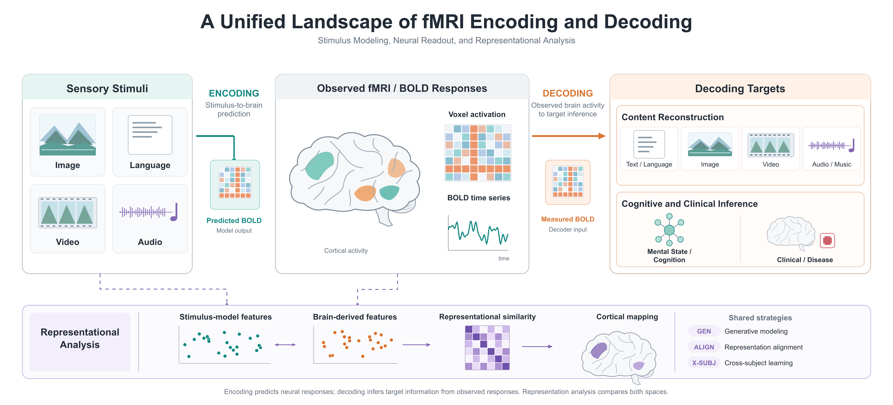
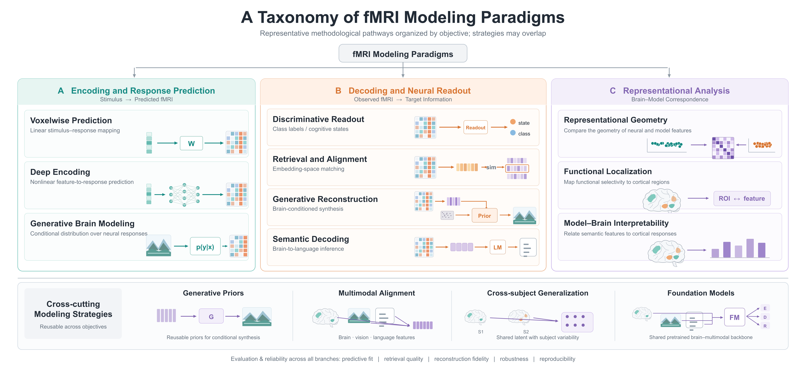

# Awesome fMRI Encoding, Decoding, and Representations

A curated list of fMRI-centric **encoding models, decoding frameworks, and representational analyses**, covering language/narrative, visual reconstruction, video, audio/music, mental state, and BCI applications.

If you find this repo helpful, please give it a ⭐ and consider contributing new papers via pull requests.

**Last Update: 2026 Nov. 22**

## Visual overview

**Figure 1. A unified landscape of fMRI encoding and decoding.** Stimuli, observed brain responses, decoding targets, and representational analysis.



**Figure 2. A taxonomy of fMRI modeling paradigms.** Encoding, decoding, representational analysis, and shared modeling strategies. The categories describe overlapping methodological pathways.



[High-resolution figures (300 DPI)](figures/README.md)

---

## Contents
- [Visual overview](#visual-overview)
- [0. Tag legend](#0-tag-legend)
- [1. Surveys / Reviews / Perspectives](#1-surveys--reviews--perspectives)
  - [1.1 Reviews](#11-reviews)
- [2. Resources](#2-resources)
  - [2.1 Task Datasets / Benchmarks](#21-task-datasets--benchmarks)
  - [2.2 Cohorts / Clinical Resources](#22-cohorts--clinical-resources)
- [3. Brain->Text / Language / Narrative](#3-brain-text--language--narrative)
  - [3.1 Language / Narrative](#31-language--narrative)
- [4. Brain->Image](#4-brain-image)
  - [4.1 Image Reconstruction](#41-image-reconstruction)
- [5. Brain->Video / Dynamic Scenes](#5-brain-video--dynamic-scenes)
  - [5.1 Dynamic Scenes](#51-dynamic-scenes)
- [6. Brain->Audio / Music](#6-brain-audio--music)
  - [6.1 Audio / Music](#61-audio--music)
- [7. Brain->Mental State / Cognition](#7-brain-mental-state--cognition)
  - [7.1 Mental State / Cognition](#71-mental-state--cognition)
- [8. Brain->Clinical / Disease](#8-brain-clinical--disease)
  - [8.1 Clinical / Disease](#81-clinical--disease)
- [9. Cross-cutting Methods](#9-cross-cutting-methods)
  - [9.1 Foundation / Multimodal / Cross-subject](#91-foundation--multimodal--cross-subject)
  - [9.2 Encoding, Representational Analysis, and Evaluation](#92-encoding-representational-analysis-and-evaluation)
- [10. Toolboxes / Libraries / Related Lists](#10-toolboxes--libraries--related-lists)
  - [10.1 Toolboxes / Libraries](#101-toolboxes--libraries)
  - [10.2 Related Lists](#102-related-lists)
- [11. Contributing](#11-contributing)


---
## 0. Tag legend

- [GEN] generative reconstruction or generation
- [ALIGN] representation, latent, semantic, or functional alignment
- [X-SUBJ] explicit cross-subject or subject-agnostic modeling

Tags describe method characteristics only. Domain, application, and code availability are represented by section placement and links, not by tags.

---


## 1. Surveys / Reviews / Perspectives

> **Scope:** Global reviews, surveys, tutorials, and perspective pieces on fMRI encoding, decoding, reconstruction, and brain-conditioned generative modeling.

### 1.1 Reviews

Encoding and decoding in fMRI
[[NeuroImage 2011](https://www.sciencedirect.com/science/article/pii/S1053811910010657)] [[DOI](https://doi.org/10.1016/j.neuroimage.2010.07.073)]

A Survey on fMRI-based Brain Decoding for Reconstructing Multimodal Stimuli
[[arXiv 2025](https://arxiv.org/abs/2503.15978)]

Brain-Conditional Multimodal Synthesis: A Survey and Taxonomy
[[IEEE TAI 2025](https://www.computer.org/csdl/journal/ai/2025/05/10798967/22EatqRGQxO)] [[Project](https://github.com/MichaelMaiii/AIGC-Brain)]

Visual Image Reconstruction from Brain Activity via Latent Representation
[[Annual Review of Vision Science 2025](https://www.annualreviews.org/content/journals/10.1146/annurev-vision-110423-023616)]

Review of visual neural encoding and decoding methods in fMRI
[[Journal of Image and Graphics 2023](https://www.cjig.cn/en/article/doi/10.11834/jig.220525)]

Visualizing the mind’s eye: a future perspective on image reconstruction from brain signals
[[Psychoradiology 2023](https://doi.org/10.1093/psyrad/kkad022)]

Deep Generative Models in Brain Encoding and Decoding
[[Engineering 2019](https://doi.org/10.1016/j.eng.2019.03.011)]

Machine Learning for Classifying Affective Valence from fMRI: A Systematic Review
[[Affective Science 2025](https://link.springer.com/article/10.1007/s44163-025-00377-8)]

Limits of Decoding Mental States with fMRI
[[NeuroImage 2022](https://pmc.ncbi.nlm.nih.gov/articles/PMC9238276/)]

Advances in Functional Magnetic Resonance Imaging-Based Brain Decoding and Its Clinical Applications
[[Psychoradiology 2025](https://doi.org/10.1093/psyrad/kkaf007)]

---

**Language and narrative reviews**

Progress, challenges and future of linguistic neural decoding with deep learning
[[Communications Biology 2025](https://www.nature.com/articles/s42003-025-08511-z)]

Artificial intelligence based multimodal language decoding from brain activity: A review
[[Brain Research Bulletin 2023](https://doi.org/10.1016/j.brainresbull.2023.110713)]

---

**General brain decoding, BCI, and deep learning perspectives**

Non-Invasive Brain-Computer Interfaces: State of the Art and Trends
[[IEEE Reviews in Biomedical Engineering 2025](https://doi.org/10.1109/RBME.2024.3449790)]

Deep learning approaches for neural decoding across multiple scales
[[Briefings in Bioinformatics 2021](https://doi.org/10.1093/bib/bbaa053)]

A Survey on Brain Encoding and Decoding
[[IJCAI 2021](https://www.ijcai.org/proceedings/2021/594)]

---

## 2. Resources

> **Scope:** Public fMRI datasets, benchmarks, and cohort-style resources. Task resources are separated from population, developmental, psychiatric, sensory-loss, and disease cohorts.

### 2.1 Task Datasets / Benchmarks

Natural Scenes Dataset (NSD) – 7T high-resolution fMRI responses to tens of thousands of natural images.
[[Nature Neuroscience 2022](https://www.nature.com/articles/s41593-021-00962-x)] [[Website](https://naturalscenesdataset.org/)] [[Data](https://osf.io/9pjky/)]

Natural Object Dataset (NOD) – large-scale fMRI dataset with 57k naturalistic images (ImageNet / COCO) from 30 participants.
[[Scientific Data 2023](https://www.nature.com/articles/s41597-023-02471-x)] [[OpenNeuro ds004496](https://openneuro.org/datasets/ds004496)]

THINGS-data / THINGS-fMRI – multimodal object-vision dataset (fMRI, MEG, behavior) over ~1.8k object concepts.
[[eLife 2023](https://elifesciences.org/articles/82580)] [[OpenNeuro ds004192](https://openneuro.org/datasets/ds004192)] [[Collection](https://doi.org/10.25452/figshare.plus.c.6161151)]

BOLD5000 – slow event-related fMRI dataset for ~5k images drawn from COCO / ImageNet / SUN.
[[Scientific Data 2019](https://www.nature.com/articles/s41597-019-0052-3)] [[Website](https://bold5000-dataset.github.io/website/)] [[OpenNeuro ds001499](https://openneuro.org/datasets/ds001499)]

Deep Image Reconstruction (DIR) dataset – single-subject fMRI for natural images used in the Kamitani deep image reconstruction work.
[[PLoS Comput Biol 2019](https://journals.plos.org/ploscompbiol/article?id=10.1371/journal.pcbi.1006633)] [[OpenNeuro ds001506](https://openneuro.org/datasets/ds001506)]

AVID: A 5T fMRI Dataset for Benchmarking Auditory-induced Visual Mental Imagery Decoding
*(5T fMRI benchmark for visual imagery prompted by spoken descriptions.)*
[[NeurIPS 2026 (accepted poster)](https://neurips.cc/virtual/2026/poster/139564)] [[arXiv](https://arxiv.org/abs/2611.02593)] [[Project](https://github.com/lishurui0612/AVID-benchmark)]

---

**Language and narrative datasets**

Narratives / Story listening datasets – multi-subject naturalistic spoken-story fMRI.
[[Scientific Data 2021](https://www.nature.com/articles/s41597-021-01033-3)] [[Website](https://www.narrativeslab.org/)] [[OpenNeuro ds002345](https://openneuro.org/datasets/ds002345)]

Semantic reconstruction of continuous language – dataset used in the Nature Neuroscience 2023 semantic decoding paper.
[[Nature Neuroscience 2023](https://www.nature.com/articles/s41593-023-01304-9)] [[OpenNeuro ds003020](https://openneuro.org/datasets/ds003020)]

Natural language fMRI dataset for voxelwise encoding models – five multi-session natural-language listening datasets for voxelwise encoding.
[[Scientific Data 2023](https://www.nature.com/articles/s41597-023-02437-z)] [[GitHub](https://github.com/HuthLab/deep-fMRI-dataset)]

Cephalonauts One: A deep fMRI dataset for decoding naturalistic speech in the human brain
*(Repeated podcast-listening fMRI sessions with a held-out audio segment retrieval benchmark.)*
[[NeurIPS 2026 (accepted poster)](https://neurips.cc/virtual/2026/poster/139123)] [[Data](https://huggingface.co/datasets/karavela/cephalonauts_one)]

---

**Video, affective, and multimodal naturalistic datasets**

CineBrain: A Large-Scale Multi-Modal Audiovisual Brain Dataset for Brain-Conditioned Video Generation
*(Synchronized fMRI and EEG during naturalistic audiovisual viewing, with the CineSync video reconstruction baseline.)*
[[CVPR 2026](https://openaccess.thecvf.com/content/CVPR2026/html/Gao_CineBrain_A_Large-Scale_Multi-Modal_Audiovisual_Brain_Dataset_for_Brain-Conditioned_Video_CVPR_2026_paper.html)] [[Project](https://jianxgao.github.io/CineBrain/)]

BOLD Moments Dataset (BMD) – video fMRI responses to ~1k short naturalistic clips with rich object / action / text metadata.
[[Nature Communications 2024](https://www.nature.com/articles/s41467-024-50310-3)] [[OpenNeuro ds005165](https://openneuro.org/datasets/ds005165)] [[Code](https://github.com/blahner/BOLDMomentsDataset)]

Spacetop – multimodal fMRI dataset with >100 participants, combining movie viewing with a broad battery of cognitive / affective tasks and physiology.
[[Scientific Data 2025](https://www.nature.com/articles/s41597-025-05154-x)] [[OpenNeuro ds005256](https://openneuro.org/datasets/ds005256)]

Emo-FilM – film-based fMRI with dense emotion annotations and concurrent physiological recordings.
[[Scientific Data 2025](https://www.nature.com/articles/s41597-025-04803-5)] [[OpenNeuro ds004892](https://openneuro.org/datasets/ds004892)]

An fMRI dataset in response to large-scale short natural dynamic facial expression videos
[[Scientific Data 2024](https://www.nature.com/articles/s41597-024-04088-0)] [[DOI](https://doi.org/10.1038/s41597-024-04088-0)]

A naturalistic fMRI dataset in response to public speaking
[[Scientific Data 2025](https://www.nature.com/articles/s41597-025-05017-5)] [[DOI](https://doi.org/10.1038/s41597-025-05017-5)]

---


### 2.2 Cohorts / Clinical Resources

Human Connectome Project (HCP, Young Adult S1200) – multimodal MRI for ~1.2k healthy young adults (3T structural, resting-state and task fMRI, diffusion MRI), with a subset scanned at 7T and some MEG; widely used for connectivity, representation learning, and population-based decoding.
[[NeuroImage 2013](https://doi.org/10.1016/j.neuroimage.2013.05.041)] [[S1200 Data Releases](https://www.humanconnectome.org/study/hcp-young-adult/data-releases)] [[S1200 Reference Manual (PDF)](https://www.humanconnectome.org/storage/app/media/documentation/s1200/HCP_S1200_Release_Reference_Manual.pdf)]

UK Biobank Imaging – very large population cohort (>100k participants targeted) with structural MRI, resting-state and task fMRI, and other imaging (cardiac, abdominal, DXA, carotid ultrasound); primarily designed for population health and genetics, but increasingly used for large-scale brain encoder pretraining and brain-phenotype prediction.
[[NeuroImage 2016](https://pmc.ncbi.nlm.nih.gov/articles/PMC5086094/)] [[Nature Communications 2020 imaging enhancement](https://www.nature.com/articles/s41467-020-15948-9)] [[Imaging project overview](https://www.ukbiobank.ac.uk/taking-part/participant-opportunities/imaging-project/)]

ABCD Study (Adolescent Brain Cognitive Development) – longitudinal cohort (~10k+ children/adolescents) with structural MRI, diffusion, resting-state and task fMRI (e.g., MID, SST, n-back), plus rich behavioral, cognitive, and environmental measures; useful for developmental decoding and pretraining.
[[Dev Cogn Neurosci 2018](https://pmc.ncbi.nlm.nih.gov/articles/PMC5999559/)] [[ABCD Study website](https://abcdstudy.org/)] [[Imaging documentation](https://docs.abcdstudy.org/latest/documentation/imaging/)]

---

**Clinical, psychiatric, sensory-loss, and developmental cohorts**

PPMI (Parkinson’s Progression Markers Initiative) – longitudinal, multi-center cohort with extensive clinical, multi-modal imaging (structural MRI, DaTscan, and additional MRI sequences at some sites), biospecimens and genetics for Parkinson’s disease and at-risk individuals; standard benchmark for PD progression modeling and biomarker discovery.
[[Prog Neurobiol 2018](https://pmc.ncbi.nlm.nih.gov/articles/PMC6292383/)] [[Study website](https://www.ppmi-info.org/)] [[Data access](https://www.ppmi-info.org/access-data-specimens/download-data)]

ADNI (Alzheimer’s Disease Neuroimaging Initiative) – multi-center longitudinal study with structural MRI, PET, some resting-state fMRI derivatives, cognitive assessments, genetics and CSF/blood biomarkers for MCI / Alzheimer’s and controls; widely used for neurodegenerative disease prediction and progression modeling.
[[ADNI neuroimaging overview](https://adni.loni.usc.edu/data-samples/adni-data/neuroimaging/)] [[ADNI MRI component](https://adni.loni.usc.edu/data-samples/adni-data/neuroimaging/mri/)] [[ADNI Data portal](https://adni.loni.usc.edu/data-samples/adni-data/)]

ABIDE I / II (Autism Brain Imaging Data Exchange) – multi-site repositories aggregating structural MRI and resting-state fMRI for individuals with autism spectrum disorder and controls; standard benchmark for ASD classification, connectome-based decoding, and cross-site generalization.
[[ABIDE overview (NeuroImage 2014)](https://pmc.ncbi.nlm.nih.gov/articles/PMC4162310/)] [[ABIDE portal](http://fcon_1000.projects.nitrc.org/indi/abide/)] [[ABIDE II](http://fcon_1000.projects.nitrc.org/indi/abide/abide_II.html)] [[ABIDE Preprocessed](https://preprocessed-connectomes-project.org/abide/)]

ADHD-200 - multi-site structural MRI and resting-state fMRI dataset for ADHD and typically-developing controls, originally released for the ADHD-200 Global Competition; extensively used as a benchmark for rs-fMRI-based psychiatric diagnosis and generalization across scanners/sites.
[[ADHD-200 portal](http://fcon_1000.projects.nitrc.org/indi/adhd200/)] [[Global Competition summary](https://pmc.ncbi.nlm.nih.gov/articles/PMC3460316/)] [[ADHD-200 Preprocessed](https://preprocessed-connectomes-project.org/adhd200/)]

Cognitive tasks, anatomical MRI, and functional MRI data evaluating the construct of self-regulation
[[Scientific Data 2024](https://www.nature.com/articles/s41597-024-03636-y)] [[DOI](https://doi.org/10.1038/s41597-024-03636-y)]

An fMRI dataset for appetite neural correlates in people living with Motor Neuron Disease
[[Scientific Data 2025](https://www.nature.com/articles/s41597-025-04828-w)] [[DOI](https://doi.org/10.1038/s41597-025-04828-w)]

101 Dalmatians: a multimodal naturalistic fMRI dataset in typical development and congenital sensory loss
[[Scientific Data 2025](https://www.nature.com/articles/s41597-025-06077-3)] [[DOI](https://doi.org/10.1038/s41597-025-06077-3)]

---

## 3. Brain->Text / Language / Narrative

> **Scope:** fMRI-to-text, language reconstruction, narrative decoding, and language-oriented alignment or generation. Method variants are indicated with [GEN], [ALIGN], and [X-SUBJ] rather than separate sub-buckets.

### 3.1 Language / Narrative

Toward a universal decoder of linguistic meaning from brain activation
[[Nature Communications 2018](https://www.nature.com/articles/s41467-018-03068-4)] [[OSF project](https://osf.io/crwz7/)]

Semantic reconstruction of continuous language from non-invasive brain recordings
[[Nature Neuroscience 2023](https://www.nature.com/articles/s41593-023-01304-9)] [[Code](https://github.com/HuthLab/semantic-decoding)] [[Dataset](https://openneuro.org/datasets/ds003020)]

FuzzyStateFormer: A Neuro-Fuzzy State-Aware Framework with Transformer Temporal Encoding for Reliability-Aware Non-Invasive Long-Sequence fMRI Semantic Decoding
*(Combines overlapping voxel-to-network memberships, temporal Transformer encoding, and teacher-derived decodability proxies for reliability-aware long-sequence semantic reconstruction.)*
[[IEEE TFS 2026 Early Access](https://ieeexplore.ieee.org/document/11769580/)] [[DOI](https://doi.org/10.1109/TFUZZ.2026.3740149)]

How Many Bytes Can You Take Out Of Brain-To-Text Decoding?
*(Information-theoretic evaluation and augmentation of fMRI→text decoders)*
[[arXiv 2024](https://arxiv.org/abs/2405.14055)]

Mind captioning: Evolving descriptive text of mental content from human brain activity
[[Science Advances 2025](https://www.science.org/doi/10.1126/sciadv.adw1464)] [[Code](https://github.com/horikawa-t/MindCaptioning)] [[OpenNeuro ds005191](https://openneuro.org/datasets/ds005191)]

Interpretable fMRI Captioning via Contrastive Learning [ALIGN]
[[MICCAI 2025](https://papers.miccai.org/miccai-2025/0459-Paper2049.html)]


---

**Representation-alignment and embedding-space decoders**

Decoding naturalistic experiences from human brain activity via distributed representations of words
[[NeuroImage 2018](https://www.sciencedirect.com/science/article/pii/S105381191730664X)]

Towards Sentence-Level Brain Decoding with Distributed Representations
[[AAAI 2019](https://ojs.aaai.org/index.php/AAAI/article/view/4685)]

Fine-grained Neural Decoding with Distributed Word Representations
[[Information Sciences 2020](https://www.sciencedirect.com/science/article/pii/S0020025519307820)]

Neural Encoding and Decoding With Distributed Sentence Representations
[[IEEE TNNLS 2021](https://doi.org/10.1109/TNNLS.2020.3027595)]

MapGuide: A Simple yet Effective Method to Reconstruct Continuous Language from Brain Activities
[[NAACL 2024](https://aclanthology.org/2024.naacl-long.211/)]

High-level visual representations in the human brain are aligned with large language models
[[Nature Machine Intelligence 2025](https://www.nature.com/articles/s42256-025-01072-0)] [[arXiv](https://arxiv.org/abs/2209.11737)] [[Code](https://github.com/adriendoerig/visuo_llm)]

---

**Generative and LLM-based decoders**

BIT-LLM: Brain Instruction Tuned LLM with persistent Cross-Attention for fMRI-to-Text Decoding [GEN] [ALIGN] [X-SUBJ]
*(Generates captions for viewed images and tests reliance on the fMRI input with perturbation controls.)*
[[ICML 2026](https://proceedings.mlr.press/v306/lee26v.html)]

Language Reconstruction with Brain Predictive Coding from fMRI Data [GEN]
[[ACL 2026](https://aclanthology.org/2026.acl-long.949/)]

Towards Brain-to-Text Generation: Neural Decoding with Pre-trained Encoder-Decoder Models
[[NeurIPS 2021 (AI4Science Workshop)](https://openreview.net/forum?id=13IJlk221xG)]

[GEN] UniCoRN: Unified Cognitive Signal ReconstructioN bridging cognitive signals and human language
[[ACL 2023](https://aclanthology.org/2023.acl-long.741/)]

[X-SUBJ] Decoding Continuous Character-based Language from Non-invasive Brain Recordings
[[bioRxiv 2024](https://www.biorxiv.org/content/10.1101/2024.03.19.585656v1)] [[arXiv](https://arxiv.org/abs/2403.11183)] [[Dataset](https://openneuro.org/datasets/ds006630)]

[GEN] BrainDEC: A Multimodal LLM for the Non-Invasive Decoding of Text from Brain Recordings
[[Information Fusion 2025](https://doi.org/10.1016/j.inffus.2025.103589)] [[Code](https://github.com/Hmamouche/brain_decode)]

Brain-Inspired fMRI-to-Text Decoding via Incremental and Wrap-Up Language Modeling (CogReader)
[[NeurIPS 2025 Spotlight](https://openreview.net/forum?id=REIo9ZLSYo)] [[Code](https://github.com/WENXUYUN/CogReader)]

[GEN] [X-SUBJ] MindLLM: A Subject-Agnostic and Versatile Model for fMRI-to-Text Decoding
[[ICML 2025 (poster)](https://openreview.net/forum?id=EiAQrilPYP)] [[arXiv 2025](https://arxiv.org/abs/2502.15786)] [[Code](https://github.com/Graph-and-Geometric-Learning/MindLLM)]

MindGPT: Interpreting What You See With Non-Invasive Brain Recordings
[[IEEE TIP 2025](https://ieeexplore.ieee.org/document/11018227)] [[Code](https://github.com/JxuanC/MindGPT)]

Open-vocabulary Auditory Neural Decoding Using fMRI-prompted LLM (Brain Prompt GPT / BP-GPT)
[[ICASSP 2025 preprint](https://arxiv.org/abs/2405.07840)] [[Code](https://github.com/1994cxy/BP-GPT)]

[GEN] Generative language reconstruction from brain recordings (BrainLLM)
[[Communications Biology 2025](https://www.nature.com/articles/s42003-025-07731-7)] [[Code](https://github.com/YeZiyi1998/Brain-language-generation)]

Brain-language fusion enables interactive neural readout and in-silico experimentation (CorText / CorText-AMA)
[[arXiv](https://arxiv.org/abs/2509.23941)]

---

**Bridge entries pending review**

[X-SUBJ] Decoding speech perception from non-invasive brain recordings *(MEG/EEG contrastive decoding of perceived speech, strong reference for non-invasive language decoding)*
[[Nature Machine Intelligence 2023](https://www.nature.com/articles/s42256-023-00714-5)] [[Code](https://github.com/facebookresearch/brainmagick)]

[X-SUBJ] Towards decoding individual words from non-invasive brain recordings *(EEG/MEG – non-fMRI but highly influential for non-invasive brain-to-text)*
[[Nature Communications 2025](https://www.nature.com/articles/s41467-025-65499-0)]

[X-SUBJ] Brain-to-Text Decoding: A Non-invasive Approach via Typing (Brain2Qwerty) *(sentence-level typing decoded from EEG/MEG)*
[[arXiv 2025](https://arxiv.org/abs/2502.17480)] [[Project page](https://ai.meta.com/research/publications/brain-to-text-decoding-a-non-invasive-approach-via-typing/)]


---

## 4. Brain->Image

> **Scope:** Visual encoding, static visual reconstruction, visual semantic decoding, and concept-level visual analysis. Tags identify generative, alignment, and cross-subject methods.

---

### 4.1 Image Reconstruction

> Early approaches that do **not** rely on modern deep generative image models, often based on hand-crafted features or simpler encoding/decoding pipelines.

Visual image reconstruction from human brain activity using a combination of multiscale local image decoders
[[Neuron 2008](https://doi.org/10.1016/j.neuron.2008.11.004)]

Reconstructing Natural Scenes from fMRI Patterns using Hierarchical Visual Features
[[NeuroImage 2011](https://doi.org/10.1016/j.neuroimage.2010.07.063)]

---

**Deep generative reconstruction with learned image priors**

> fMRI→image reconstruction that uses **deep generative models** as image priors (GAN, latent diffusion, Stable Diffusion variants, etc.).

Deep image reconstruction from human brain activity
[[PLoS Comput Biol 2019](https://journals.plos.org/ploscompbiol/article?id=10.1371/journal.pcbi.1006633)] [[Code](https://github.com/KamitaniLab/DeepImageReconstruction)] [[Dataset](https://openneuro.org/datasets/ds001506)]

From voxels to pixels and back: Self-supervision in natural-image reconstruction from fMRI
[[NeurIPS 2019](https://arxiv.org/abs/1907.02431)] [[Code](https://github.com/WeizmannVision/ssfmri2im)]

High-resolution image reconstruction with latent diffusion models from human brain activity [GEN]
[[CVPR 2023](https://openaccess.thecvf.com/content/CVPR2023/html/Takagi_High-Resolution_Image_Reconstruction_With_Latent_Diffusion_Models_From_Human_Brain_CVPR_2023_paper.html)] [[Project](https://sites.google.com/view/stablediffusion-with-brain/)] [[Code](https://github.com/yu-takagi/StableDiffusionReconstruction)]

Seeing Beyond the Brain: Conditional Diffusion Model with Sparse Masked Modeling for Vision Decoding (MinD-Vis)
[[CVPR 2023](https://openaccess.thecvf.com/content/CVPR2023/papers/Chen_Seeing_Beyond_the_Brain_Conditional_Diffusion_Model_With_Sparse_Masked_CVPR_2023_paper.pdf)] [[Project](https://mind-vis.github.io/)]

Reconstructing the Mind's Eye: fMRI-to-Image with Contrastive Learning and Diffusion Priors (MindEye) [GEN] [ALIGN]
[[NeurIPS 2023](https://arxiv.org/abs/2305.18274)] [[Project](https://medarc-ai.github.io/mindeye/)] [[Code](https://github.com/MedARC-AI/fMRI-reconstruction-NSD)]

MindDiffuser: Controlled Image Reconstruction from Human Brain Activity with Semantic and Structural Diffusion
[[ACM MM 2023](https://dl.acm.org/doi/10.1145/3581783.3613819)] [[arXiv](https://arxiv.org/abs/2308.04249)] [[Code](https://github.com/YingxingLu/MindDiffuser)]

Dual-Guided Brain Diffusion Model: Natural Image Reconstruction from Human Visual Stimulus fMRI (DBDM)
[[Bioengineering 2023](https://www.mdpi.com/2306-5354/10/10/1117)]

Mental image reconstruction from human brain activity
[[Neural Networks 2024](https://www.sciencedirect.com/science/article/pii/S0893608023006470)]

NeuralDiffuser: Neuroscience-Inspired Diffusion Guidance for fMRI Visual Reconstruction
[[IEEE TIP 2025](https://ieeexplore.ieee.org/document/10749645)] [[arXiv](https://arxiv.org/abs/2401.01713)]

Balancing Semantic and Structural Decoding for fMRI-to-Image Reconstruction
[[Expert Systems with Applications 2025](https://www.sciencedirect.com/science/article/abs/pii/S0957417425034517)]

Towards Interpretable Visual Decoding with Attention to Brain Representations [GEN]
[[ICLR 2026](https://openreview.net/forum?id=YWlYITAhMC)]

Seeing Through the Brain: New Insights from Decoding Visual Stimuli with fMRI [GEN] [ALIGN]
[[ICLR 2026](https://openreview.net/forum?id=88ZLp7xYxw)]

Moving Beyond Diffusion: Hierarchy-to-Hierarchy Autoregression for fMRI-to-Image Reconstruction [GEN] [ALIGN]
[[ICLR 2026](https://openreview.net/forum?id=AT7hCh6HB7)]

MIRAGE: Robust multi-modal architectures translate fMRI-to-image models from vision to mental imagery [GEN] [ALIGN]
[[arXiv 2026](https://arxiv.org/abs/2605.17198)]

Follow-Your-Mind: Towards Inversion-Free Brain-Driven Visual Context Synthesis and Editing [GEN] [ALIGN]
[[ECCV 2026 (official poster)](https://eccv.ecva.net/virtual/2026/poster/3632)] [[PDF](https://media.eventhosts.cc/Conferences/ECCV2026/pdfs/2275.pdf)]

Single-Stage fMRI-to-3D Reconstruction via Viewpoint-Aware Embedding and Hierarchical Guidance [GEN]
[[AAAI 2026](https://ojs.aaai.org/index.php/AAAI/article/view/38864)]

---

**Cross-subject and universal visual decoders / encoders**

> Brain->image decoders and image→fMRI encoders that explicitly target **cross-subject / cross-site generalization**, few-shot adaptation, or universal representations.
> Tagged with **[X-SUBJ]** when cross-subject generalization is a core focus, **[ALIGN]** when explicit representation or functional alignment is central, and **[GEN]** only when the method performs generative reconstruction or generation.
> Some of these also relate to generative image reconstruction or cross-cutting foundation methods; we keep them here when the primary contribution is image-first visual decoding or reconstruction.

MindEye2 [GEN] [ALIGN] [X-SUBJ]: Shared-Subject Models Enable fMRI-To-Image With 1 Hour of Data
[[ICML 2024](https://proceedings.mlr.press/v235/scotti24a.html)] [[arXiv](https://arxiv.org/abs/2403.11207)] [[Project](https://medarc-ai.github.io/mindeye2/)] [[Code](https://github.com/MedARC-AI/MindEyeV2)]

MindAligner: Explicit Brain Functional Alignment for Cross-Subject Visual Decoding from Limited fMRI Data [ALIGN] [X-SUBJ]
[[ICML 2025](https://proceedings.mlr.press/v267/dai25m.html)]

[X-SUBJ] ZEBRA: Towards Zero-Shot Cross-Subject Generalization for Universal Brain Visual Decoding
[[NeurIPS 2025](https://openreview.net/pdf/7a4f583ef54685490be5c58986a3ad803aac087c.pdf)] [[Code](https://github.com/xmed-lab/ZEBRA)]

Psychometry [GEN] [X-SUBJ]: An Omnifit Model for Image Reconstruction from Human Brain Activity
[[CVPR 2024](https://openaccess.thecvf.com/content/CVPR2024/html/Quan_Psychometry_An_Omnifit_Model_for_Image_Reconstruction_from_Human_Brain_CVPR_2024_paper.html)] [[arXiv](https://arxiv.org/abs/2403.20022)] [[Related TPAMI 2026 Early Access](https://doi.org/10.1109/TPAMI.2026.3738650)]

[X-SUBJ] NeuroPictor: Refining fMRI-to-Image Reconstruction via Multi-individual Pretraining and Multi-level Modulation
[[ECCV 2024](https://www.ecva.net/papers/eccv_2024/papers_ECCV/papers/06746.pdf)] [[arXiv](https://arxiv.org/abs/2403.18211)] [[Project](https://jingyanghuo.github.io/neuropictor/)]

[X-SUBJ] Wills Aligner: Multi-Subject Collaborative Brain Visual Decoding
[[AAAI 2025](https://ojs.aaai.org/index.php/AAAI/article/view/33554)] [[arXiv](https://arxiv.org/abs/2404.13282)]

[X-SUBJ] BrainGuard: Privacy-Preserving Multisubject Image Reconstructions from Brain Activities
[[AAAI 2025 (Oral)](https://ojs.aaai.org/index.php/AAAI/article/view/33579)] [[arXiv](https://arxiv.org/abs/2501.14309)] [[Project](https://github.com/kunzhan/brainguard)]

[X-SUBJ] MoRE-Brain: Routed Mixture of Experts for Interpretable and Generalizable Cross-Subject fMRI Visual Decoding
[[NeurIPS 2025](https://openreview.net/forum?id=fYSPRGmS6l)] [[arXiv](https://arxiv.org/abs/2505.15946)] [[Code](https://github.com/yuxiangwei0808/MoRE-Brain)]

[X-SUBJ] Inter-individual and inter-site neural code conversion without shared stimuli
*(General-purpose cross-subject / cross-site alignment that can support various decoding tasks beyond visual reconstruction.)*
[[Nature Computational Science 2025](https://doi.org/10.1038/s43588-025-00826-5)]

Self-Supervised Natural Image Reconstruction and Large-Scale Semantic Classification from Brain Activity
[[NeuroImage 2022](https://www.sciencedirect.com/science/article/pii/S105381192200249X)]

[X-SUBJ] The Wisdom of a Crowd of Brains: A Universal Brain Encoder
[[arXiv 2024](https://arxiv.org/abs/2406.12179)]

SynBrain: Enhancing Visual-to-fMRI Synthesis via Probabilistic Representation Learning
[[arXiv 2025](https://arxiv.org/abs/2508.10298)] [[NeurIPS 2025](https://openreview.net/forum?id=ZTHYaSxqmq)]

Beyond Grid-Locked Voxels: Neural Response Functions for Continuous Brain Encoding [ALIGN] [X-SUBJ]
[[ICLR 2026](https://openreview.net/forum?id=wBKXuuLZbc)]

Brain-IT: Image Reconstruction from fMRI via Brain-Interaction Transformer [GEN] [X-SUBJ]
[[ICLR 2026](https://openreview.net/forum?id=9KjXqkfbPw)]

StableMind: Source-Free Cross-Subject fMRI Decoding with Regularized Adaptation [ALIGN] [X-SUBJ]
[[arXiv 2026](https://arxiv.org/abs/2605.02586)]

NeurIPS: Neuro-anatomical Inductive Priors for Sphere-based Brain Decoding [ALIGN] [X-SUBJ]
[[ICML 2026](https://proceedings.mlr.press/v306/yu26g.html)] [[arXiv](https://arxiv.org/abs/2605.24993)] [[Code](https://github.com/SCUT-Xinlab/NeurIPS)]

Meta-Learning In-Context Enables Training-Free Cross Subject Brain Decoding [ALIGN] [X-SUBJ]
*(Uses paired examples from the new subject as context without fine-tuning.)*
[[CVPR 2026](https://openaccess.thecvf.com/content/CVPR2026/html/Nan_Meta-Learning_In-Context_Enables_Training-Free_Cross_Subject_Brain_Decoding_CVPR_2026_paper.html)]

Modeling the Brain's Grammar: ROI-Guided fMRI Pretraining for Transferable and Interpretable Vision Decoding [ALIGN] [X-SUBJ]
[[CVPR 2026](https://openaccess.thecvf.com/content/CVPR2026/html/Liu_Modeling_the_Brains_Grammar_ROI-Guided_fMRI_Pretraining_for_Transferable_and_CVPR_2026_paper.html)]

Duala: Dual-Level Alignment of Subjects and Stimuli for Cross-Subject fMRI Decoding [GEN] [ALIGN] [X-SUBJ]
[[CVPR 2026](https://openaccess.thecvf.com/content/CVPR2026/html/Li_Duala_Dual-Level_Alignment_of_Subjects_and_Stimuli_for_Cross-Subject_fMRI_CVPR_2026_paper.html)]

ConnecToMind2: Inter-Subject fMRI Decoding via Whole-Brain Connectome-Guided Alignment [GEN] [ALIGN] [X-SUBJ]
[[MICCAI 2026](https://papers.miccai.org/miccai-2026/0197-Paper1776.html)]

Reconstructing shared visual experiences from human brain activity across individuals (MindShow) [GEN] [ALIGN] [X-SUBJ]
*(Adapts a shared visual reconstruction model with a limited amount of target-subject calibration data.)*
[[Medical Image Analysis 2026](https://doi.org/10.1016/j.media.2026.104157)] [[Code](https://github.com/AI-NMI/MindShow)]

fMRI-based cross-subject visual reconstruction via structural consistency and multi-scale cortical modeling [GEN] [ALIGN] [X-SUBJ]
[[Information Fusion 2026](https://doi.org/10.1016/j.inffus.2026.104352)]

---

**Interpretability and concept-level decoding**

> Brain->image pipelines that explicitly emphasize **interpretability**, concept-level representations, or analysis of how much information generative priors actually extract from the brain (e.g., concept bottlenecks, probing, attribution analyses).

MindReader: Reconstructing complex images from brain activities
[[NeurIPS 2022](https://arxiv.org/abs/2209.12951)] [[Code](https://github.com/yuvalsim/MindReader)]

Bridging Brains and Concepts: Interpretable Visual Decoding from fMRI with Semantic Bottlenecks
[[NeurIPS 2025 Poster](https://openreview.net/forum?id=K6ijewH34E)] [[PDF](https://openreview.net/pdf?id=K6ijewH34E)]

BrainBits: How Much of the Brain are Generative Reconstruction Methods Using?
[[NeurIPS 2024](https://openreview.net/forum?id=KAAUvi4kpb)] [[arXiv](https://arxiv.org/abs/2411.02783)] [[Code](https://github.com/czlwang/BrainBits)]

Neuro-Symbolic Decoding of Neural Activity [ALIGN]
[[ICLR 2026](https://openreview.net/forum?id=alEx0sm74l)]

---

**Visual encoding and bidirectional modeling**

NeuroFlow: Toward Unified Visual Encoding and Decoding from Neural Activity [GEN] [ALIGN]
[[CVPR 2026](https://openaccess.thecvf.com/content/CVPR2026/html/Mai_NeuroFlow_Toward_Unified_Visual_Encoding_and_Decoding_from_Neural_Activity_CVPR_2026_paper.html)]

Rest2Visual: Predicting Visually Evoked fMRI from Resting-State Scans
[[MICCAI 2026](https://papers.miccai.org/miccai-2026/0888-Paper2424.html)]

---

## 5. Brain->Video / Dynamic Scenes

> **Scope:** Predicting fMRI responses to dynamic visual stimuli, and decoding or reconstructing movies and other dynamic scenes from fMRI.

---

### 5.1 Dynamic Scenes

> Encoding-model and decoding pipelines for natural movies, often predicting voxel responses from visual features and then decoding semantic content or categories.

Reconstructing visual experiences from brain activity evoked by natural movies
[[Current Biology 2011](https://www.sciencedirect.com/science/article/pii/S0960982211009377)]

Neural encoding and decoding with deep learning for dynamic natural vision
[[Cerebral Cortex 2018](https://academic.oup.com/cercor/article/28/12/4136/4560155)]

The Algonauts Project 2021 Challenge: How the Human Brain Makes Sense of a World in Motion
*(Benchmark challenge for predicting fMRI responses to >1k short everyday videos.)*
[[arXiv 2021](https://arxiv.org/abs/2104.13714)] [[Challenge](http://algonauts.csail.mit.edu/)]

TRIBE: TRImodal Brain Encoder for whole-brain fMRI response prediction [ALIGN]
[[ICLR 2026](https://openreview.net/forum?id=biegtqdqmg)]

MIRAGE: Adaptive Multimodal Gating for Whole-Brain fMRI Encoding [ALIGN]
[[NeurIPS 2026 (accepted poster)](https://neurips.cc/virtual/2026/poster/149712)] [[arXiv](https://arxiv.org/abs/2605.29850)]

A topographic video model predicts the spatio-functional organization of the human visual system
[[Nature Communications 2026](https://doi.org/10.1038/s41467-026-78948-1)]

---

**Representation-alignment and retrieval-based video decoders**

> Approaches that map fMRI into a **shared embedding space** (e.g., clip-level or text-level representations) and then perform video **retrieval** or matching, often with the help of multimodal large models.

Mind2Word: Towards Generalized Visual Neural Representations for High-Quality Video Reconstruction
– Maps fMRI into a sequence of pseudo-words in a text embedding space, and then uses a video generator for high-quality reconstruction.
[[Expert Systems with Applications 2025](https://www.sciencedirect.com/science/article/pii/S095741742502771X)]

Decoding the Moving Mind: Multi-Subject fMRI-to-Video Retrieval with MLLM Semantic Grounding
– Multi-subject fMRI-to-video retrieval using multimodal large language models to ground semantic similarity between brain activity and candidate clips.
[[bioRxiv 2025](https://www.biorxiv.org/content/10.1101/2025.04.07.647335v1)]


---

**Deep generative fMRI-to-video reconstruction**

> Models that aim to **reconstruct full video sequences** (or high-frame-rate approximations) from fMRI, typically using deep video generators or diffusion models conditioned on brain activity.

Reconstructing rapid natural vision with fMRI-conditional video generative adversarial network
[[Cerebral Cortex 2022](https://academic.oup.com/cercor/article/32/20/4502/6515038)]

A Penny for Your (visual) Thoughts: Self-Supervised Reconstruction of Natural Movies from Brain Activity
[[arXiv 2022](https://arxiv.org/abs/2206.03544)]

Cinematic Mindscapes: High-quality Video Reconstruction from Brain Activity (Mind-Video) [GEN] [ALIGN]
[[NeurIPS 2023](https://proceedings.neurips.cc/paper_files/paper/2023/file/4e5e0daf4b05d8bfc6377f33fd53a8f4-Paper-Conference.pdf)] [[Project](https://www.mind-video.com/)]

Animate Your Thoughts: Decoupled Reconstruction of Dynamic Natural Vision from Slow Brain Activity (Mind-Animator) [GEN]
[[ICLR 2025](https://openreview.net/forum?id=BpfsxFqhGa)] [[arXiv](https://arxiv.org/abs/2405.03280)] [[Project](https://mind-animator-design.github.io/)]

NeuroClips: Towards High-fidelity and Smooth fMRI-to-Video Reconstruction [GEN]
[[NeurIPS 2024](https://proceedings.neurips.cc/paper_files/paper/2024/hash/5c594bf6223b67109441c9e0c97542ed-Abstract-Conference.html)] [[Code](https://github.com/gongzix/NeuroClips)]

A Cognitive Process-Inspired Architecture for Subject-Agnostic Brain Visual Decoding [GEN] [ALIGN] [X-SUBJ]
[[ICLR 2026](https://openreview.net/forum?id=H1GLFKk0xE)]

Bridging Brain and Semantics: A Hierarchical Framework for Semantically Enhanced fMRI-to-Video Reconstruction [GEN] [ALIGN]
[[CVPR 2026](https://openaccess.thecvf.com/content/CVPR2026/html/Wei_Bridging_Brain_and_Semantics_A_Hierarchical_Framework_for_Semantically_Enhanced_CVPR_2026_paper.html)] [[arXiv](https://arxiv.org/abs/2605.14569)]

MindCross: Fast New Subject Adaptation with Limited Data for Cross-subject Video Reconstruction from Brain Signals [GEN] [X-SUBJ]
[[AAAI 2026](https://ojs.aaai.org/index.php/AAAI/article/view/38814)] [[Code](https://github.com/XuanhaoLiu/MindCross)]

SemVideo: Reconstructs What You Watch from Brain Activity via Hierarchical Semantic Guidance [GEN] [ALIGN]
[[CVPR 2026](https://openaccess.thecvf.com/content/CVPR2026/html/Yang_SemVideo_Reconstructs_What_You_Watch_from_Brain_Activity_via_Hierarchical_CVPR_2026_paper.html)]

CortexVideo: A Semantic-Spatial Dual-Anchor Framework for High-Fidelity fMRI-to-Video Reconstruction [GEN] [ALIGN]
[[ECCV 2026 (official poster)](https://eccv.ecva.net/virtual/2026/poster/4246)] [[PDF](https://media.eventhosts.cc/Conferences/ECCV2026/pdfs/5081.pdf)]

---

## 6. Brain->Audio / Music

> **Scope:** fMRI-centric decoding approaches where the output is sound, music, or audio features. Non-fMRI audio bridge entries are retained only as review-needed references until the bridge policy is finalized.

### 6.1 Audio / Music

Capturing the musical brain with Lasso: Dynamic decoding of musical features from fMRI data
[[NeuroImage 2014](https://www.sciencedirect.com/science/article/pii/S1053811913011099)] [[DOI](https://doi.org/10.1016/j.neuroimage.2013.11.017)]

Text-to-music generation models capture musical semantic representations in the human brain (Brain2Music) [GEN]
[[Nature Communications 2026 (online 2025)](https://www.nature.com/articles/s41467-025-66731-7)] [[arXiv](https://arxiv.org/abs/2307.11078)] [[Project](https://google-research.github.io/seanet/brain2music/)]

Reconstructing Music Perception from Brain Activity Using a Prior-Guided Diffusion Model
[[Scientific Reports 2025](https://www.nature.com/articles/s41598-025-26095-w)]

R&B - Rhythm and Brain: Cross-Subject Music Decoding from fMRI via Prior-Guided Diffusion Model
[[Preprint 2025](https://doi.org/10.21203/rs.3.rs-7301336/v1)]

Identifying musical pieces from fMRI data using encoding and decoding models
[[Scientific Reports 2018](https://www.nature.com/articles/s41598-018-20732-3)]

Direct Conditioning of Audio Diffusion Transformers on fMRI Reveals Cortical Contributions to Sound Reconstruction [GEN]
[[NeurIPS 2026 (accepted poster)](https://neurips.cc/virtual/2026/poster/152995)]

**Bridge entries pending review**

Music Can Be Reconstructed from Human Auditory Cortex Activity Using Nonlinear Decoding Models *(iEEG)*
[[PLOS Biology 2023](https://journals.plos.org/plosbiology/article?id=10.1371/journal.pbio.3002176)]

Neural Decoding of Music from the EEG *(EEG combined with fMRI-informed source localisation)*
[[Scientific Reports 2023](https://www.nature.com/articles/s41598-022-27361-x)]

Decoding Reveals the Neural Representation of Perceived and Imagined Musical Sounds *(MEG)*
[[PLOS Biology 2024](https://journals.plos.org/plosbiology/article?id=10.1371/journal.pbio.3002858)]

---

## 7. Brain->Mental State / Cognition

> **Scope:** fMRI-based decoding of affect, attention, cognition, mental imagery, spontaneous thought, subjective content, and related mental-state constructs when the target is not disease diagnosis or a clinical biomarker.

### 7.1 Mental State / Cognition

Brain Decoding of Spontaneous Thought: Predictive Modeling of Self-Relevance and Valence Using Personal Narratives
[[PNAS 2024](https://www.pnas.org/doi/10.1073/pnas.2401959121)]

Spatial representation of multidimensional information in emotional faces revealed by fMRI
[[NeuroImage 2024](https://www.sciencedirect.com/science/article/pii/S1053811924000739)] [[DOI](https://doi.org/10.1016/j.neuroimage.2024.120578)]

BrainCodec: Neural fMRI Codec for the Decoding of Cognitive Brain States
[[arXiv 2024](https://arxiv.org/abs/2410.04383)] [[Code](https://github.com/amano-k-lab/BrainCodec)]

Brain Decoding of the Human Connectome Project Tasks in a Dense Individual fMRI Dataset
[[NeuroImage 2023](https://doi.org/10.1016/j.neuroimage.2023.120395)]

Probabilistic Cognitive State Modeling (PCSM): Decoding dynamic brain states to derive emergent cognitive processing properties from task fMRI
[[NeuroImage 2026](https://www.sciencedirect.com/science/article/pii/S1053811926001254)] [[DOI](https://doi.org/10.1016/j.neuroimage.2026.121807)]

CBrain: Cross-Modal Learning for Brain Vigilance Detection in Resting-State fMRI [ALIGN]
[[MICCAI 2025](https://papers.miccai.org/miccai-2025/0138-Paper4486.html)]

Real-time decoding of covert attention in higher-order visual areas
[[NeuroImage 2018](https://www.sciencedirect.com/science/article/pii/S105381191731042X)] [[DOI](https://doi.org/10.1016/j.neuroimage.2017.12.019)]

Decoding the visual and subjective contents of the human brain
[[Nature Neuroscience 2005](https://www.nature.com/articles/nn1444)] [[DOI](https://doi.org/10.1038/nn1444)]

Neural decoding of autobiographical mental image features with a general semantic model [ALIGN]
[[Nature Communications 2025](https://www.nature.com/articles/s41467-025-65541-1)] [[DOI](https://doi.org/10.1038/s41467-025-65541-1)]

Explainable Deep-Learning Framework: Decoding Brain Task and Predicting Individual Performance in False-Belief Tasks at Early Childhood Stage
[[Preprint 2024](https://www.biorxiv.org/content/10.1101/2024.02.29.582682v1)]

Scaling Vision Transformers for Functional MRI with Flat Maps
[[NeurIPS 2025 Workshop](https://openreview.net/forum?id=L0CpmKEVHw)] [[arXiv](https://arxiv.org/abs/2510.13768)] [[Code](https://github.com/MedARC-AI/fmri-fm)]

Benchmarking Explanation Methods for Mental State Decoding with Deep Learning Models
[[NeuroImage 2023](https://doi.org/10.1016/j.neuroimage.2023.120109)] [[Code](https://github.com/athms/xai-brain-decoding-benchmark)]

The representational geometry of cognitive maps under cognitive control
[[Nature Communications 2026](https://doi.org/10.1038/s41467-026-77621-x)]

Causal role of human hippocampus in relational structure learning and inference
[[Nature Human Behaviour 2026](https://doi.org/10.1038/s41562-026-02627-w)]

NiCLIP: neuroimaging contrastive language-image pretraining model for predicting text from brain activation images [ALIGN]
*(Predicts cognitive tasks and concepts from activation maps, with strongest results on group-level maps.)*
[[Nature Communications 2026](https://doi.org/10.1038/s41467-026-78451-7)]

ASFFNet: Adaptive structural-functional brain connectome fusion for dynamic cognitive inference
[[Information Fusion 2027 (online by Nov 2026)](https://doi.org/10.1016/j.inffus.2026.104708)]

---

## 8. Brain->Clinical / Disease

> **Scope:** Disease, biomarker, psychiatric, diagnosis, risk, or progression-oriented fMRI decoding and clinically targeted brain-network modeling.

### 8.1 Clinical / Disease

Robust computation of subcortical functional connectivity guided by quantitative susceptibility mapping: An application in Parkinson's disease diagnosis
[[NeuroImage 2025](https://www.sciencedirect.com/science/article/pii/S1053811925002599)] [[DOI](https://doi.org/10.1016/j.neuroimage.2025.121256)]

Decoding dynamic brain networks in Parkinson's disease with temporal attention
[[Scientific Reports 2025](https://www.nature.com/articles/s41598-025-01106-y)] [[DOI](https://doi.org/10.1038/s41598-025-01106-y)]

GraSTI-ACL: Graph spatial-temporal infomax with adversarial contrastive learning for brain disorders diagnosis based on resting-state fMRI
[[Medical Image Analysis 2026](https://www.sciencedirect.com/science/article/pii/S1361841525003615)] [[DOI](https://doi.org/10.1016/j.media.2025.103815)]

Foundation-Model-Boosted Multimodal Learning for fMRI-based Neuropathic Pain Drug Response Prediction [ALIGN]
[[MICCAI 2025](https://papers.miccai.org/miccai-2025/0349-Paper1399.html)]

Inflated Performance in fMRI-Based ASD Diagnosis: A Reproducibility Study of Data Leakage in Feature Selection Pipelines
*(Re-evaluates two ABIDE I classification pipelines after correcting feature-selection leakage.)*
[[MICCAI 2026](https://papers.miccai.org/miccai-2026/0496-Paper5823.html)]

*(See also Section 2.2 for large-scale clinical, psychiatric, developmental, and disease cohorts used as downstream benchmarks.)*

---

## 9. Cross-cutting Methods

> **Scope:** Foundation models, methods spanning tasks or modalities, and studies of encoding, brain and model representations, and evaluation. Task-specific applications are listed in their corresponding sections.

### 9.1 Foundation / Multimodal / Cross-subject

Across-subject ensemble-learning alleviates the need for large samples for fMRI decoding [X-SUBJ]
[[MICCAI 2024](https://papers.miccai.org/miccai-2024/043-Paper2040.html)] [[DOI](https://doi.org/10.1007/978-3-031-72384-1_4)] [[Code](https://github.com/man-shu/ensemble-fmri)]

Spatio-temporal Pre-trained Foundation Model for Neural Decoding with Fine-grained Optimization
[[MICCAI 2025](https://papers.miccai.org/miccai-2025/0854-Paper2630.html)] [[DOI](https://doi.org/10.1007/978-3-032-04947-6_58)]

Towards neural foundation models for vision: Aligning EEG, MEG, and fMRI representations for decoding, encoding, and modality conversion [ALIGN]
[[Information Fusion 2026](https://www.sciencedirect.com/science/article/pii/S1566253525007225)] [[DOI](https://doi.org/10.1016/j.inffus.2025.103650)]

UMBRAE: Unified Multimodal Brain Decoding [ALIGN] [X-SUBJ]
[[ECCV 2024](https://www.ecva.net/papers/eccv_2024/papers_ECCV/papers/01133.pdf)] [[Project](https://weihaox.github.io/UMBRAE/)] [[Code](https://github.com/weihaox/UMBRAE)]

BrainCLIP: Bridging Brain and Visual-Linguistic Representation via CLIP for Generic Natural Visual Stimulus Decoding [ALIGN]
[[arXiv 2023](https://arxiv.org/abs/2302.12971)] [[Code](https://github.com/YulongBonjour/BrainCLIP)]

Modality-Agnostic fMRI Decoding of Vision and Language [ALIGN]
[[ICLR 2024 Workshop](https://openreview.net/forum?id=7gWQL0hTrX)] [[arXiv](https://arxiv.org/abs/2403.11771)]

Brain Harmony: A Multimodal Foundation Model Unifying Morphology and Function into 1D Tokens [X-SUBJ]
[[NeurIPS 2025](https://openreview.net/pdf/80edac1ff79b10252bcd8be5794855fadbd39ea9.pdf)] [[Code](https://github.com/hzlab/Brain-Harmony)]

Orthogonal Contrastive Learning for Multi-Representation fMRI Analysis [ALIGN] [X-SUBJ]
[[NeurIPS 2025](https://papers.nips.cc/paper_files/paper/2025/hash/a81a1eabfb6cbece73ddd0e6a1645d67-Abstract-Conference.html)]

Brain-Semantoks: Learning Semantic Tokens of Brain Dynamics with a Self-Distilled Foundation Model [ALIGN]
[[ICLR 2026](https://openreview.net/forum?id=ANkm27vNuk)]

Stochastic Optimal Control for Continuous-Time fMRI Representation Learning [ALIGN]
[[ICLR 2026](https://openreview.net/forum?id=N51nP3TBwR)]

FlexiBrain: Resolution-Agnostic Voxel-Level Encoding for Native fMRI [ALIGN]
[[ECCV 2026 (official poster)](https://eccv.ecva.net/virtual/2026/poster/3953)] [[arXiv](https://arxiv.org/abs/2606.11500)] [[PDF](https://media.eventhosts.cc/Conferences/ECCV2026/pdfs/3829.pdf)]

Omni-fMRI: A Universal Atlas-Free fMRI Foundation Model [ALIGN]
[[ICML 2026](https://proceedings.mlr.press/v306/wang26jv.html)] [[arXiv](https://arxiv.org/abs/2601.23090)]

fMRI-LM: Towards a Universal Foundation Model for Language-Aligned fMRI Understanding [ALIGN]
[[CVPR 2026](https://openaccess.thecvf.com/content/CVPR2026/html/Wei_fMRI-LM_Towards_a_Universal_Foundation_Model_for_Language-Aligned_fMRI_Understanding_CVPR_2026_paper.html)] [[arXiv](https://arxiv.org/abs/2511.21760)]

Mind-Omni: A Unified Multi-Task Framework for Brain-Vision-Language Modeling via Discrete Diffusion [GEN] [ALIGN]
[[ICML 2026](https://proceedings.mlr.press/v306/lu26d.html)] [[Code](https://github.com/ReedOnePeck/Mind-Omni)]

BrainJanus: A Unified Model for Understanding and Generation across Brain, Vision, and Language [GEN] [ALIGN]
[[ICML 2026](https://proceedings.mlr.press/v306/wu26cd.html)] [[Code](https://github.com/HaitaoWuTJU/BrainJanus)]

Brain-OF: An Omnifunctional Foundation Model for fMRI, EEG and MEG [ALIGN]
[[NeurIPS 2026 (accepted poster)](https://neurips.cc/virtual/2026/poster/155505)]

MnemoDyn: Learning Resting State Dynamics from 40K fMRI sequences
[[ICLR 2026](https://proceedings.iclr.cc/paper_files/paper/2026/hash/24faedc5853648d5857f2cf086a2acac-Abstract-Conference.html)]

A Brain Graph Foundation Model: Pre-Training and Prompt-Tuning across Broad Atlases and Disorders
[[ICLR 2026](https://proceedings.iclr.cc/paper_files/paper/2026/hash/fdf5965c14708e90eba7f8f77d24ff4c-Abstract-Conference.html)] [[Code](https://github.com/weixinxu666/BrainGFM)]

Brain-DiT: A Universal Multi-state fMRI Foundation Model with Metadata-Conditioned Pretraining
[[MICCAI 2026](https://papers.miccai.org/miccai-2026/0120-Paper1362.html)]

### 9.2 Encoding, Representational Analysis, and Evaluation

> **Scope:** Stimulus-to-fMRI response prediction, analyses of brain and model representations, and evaluation methods for encoding and decoding. See Sections 4 and 5 for visual and video-specific encoding models.

**Encoding and response prediction**

See Beyond Words: Joint Visual–Language Representations Improve Brain Encoding of Language-Only Stimuli [ALIGN]
*(Uses visual augmentation to predict fMRI responses to spoken narratives.)*
[[EMNLP 2026](https://aclanthology.org/2026.emnlp-main.935/)]

Linguistic Properties and Model Scale in Brain Encoding: From Small to Compressed Language Models [ALIGN]
[[ICML 2026](https://proceedings.mlr.press/v306/oota26a.html)]

RABBiT: Rapidly adaptive BOLD foundation model via brain-tuning for accurate zero-shot and few-shot prediction of speech-elicited responses in the brain [ALIGN] [X-SUBJ]
[[NeurIPS 2026 (accepted poster)](https://neurips.cc/virtual/2026/poster/148160)]

Learning Sparse Semantic-Cortical Atoms for Multisubject Naturalistic fMRI Encoding [ALIGN] [X-SUBJ]
[[NeurIPS 2026 (accepted poster)](https://neurips.cc/virtual/2026/poster/151712)]

BrainVista: Modeling Naturalistic Brain Dynamics as Multimodal Next-Token Prediction [GEN]
*(Forecasts future fMRI states from past brain activity and observed stimuli.)*
[[NeurIPS 2026 (accepted poster)](https://neurips.cc/virtual/2026/poster/153166)]

**Representational analysis and alignment**

The Mind's Transformer: Computational Neuroanatomy of LLM-Brain Alignment [ALIGN]
[[ICLR 2026](https://proceedings.iclr.cc/paper_files/paper/2026/hash/9e89f068a62f6858c661a8abecf5bb0a-Abstract-Conference.html)] [[Code](https://github.com/cheng-yeh/MindTransformer)]

When Language Models Lose Their Mind: The Consequences of Brain Misalignment [ALIGN]
[[ICLR 2026](https://proceedings.iclr.cc/paper_files/paper/2026/hash/864b96035c34651e12202f8cd1d5e945-Abstract-Conference.html)]

Beyond representational alignment with brain-guided language models for robust reasoning [ALIGN]
[[Nature Machine Intelligence 2026](https://www.nature.com/articles/s42256-026-01278-w)]

Platonic Representations in the Human Brain: Unsupervised Recovery of Universal Geometry [ALIGN] [X-SUBJ]
[[NeurIPS 2026 (accepted poster)](https://neurips.cc/virtual/2026/poster/148860)]

Network geometry shapes the transformation of task representations across the human cortex
[[Nature Neuroscience 2026](https://doi.org/10.1038/s41593-026-02486-8)]

Prototypes of the Mind: A Unified Framework for Probing the Visual Brain [ALIGN]
[[NeurIPS 2026 (accepted poster)](https://neurips.cc/virtual/2026/poster/153745)] [[arXiv](https://arxiv.org/abs/2611.15046)]

**Evaluation, reliability, and data splits**

Accuracy of Noise Ceiling Estimators for Brain Scores
[[NeurIPS 2026 (accepted poster)](https://neurips.cc/virtual/2026/poster/154840)]

Only Brains Align with Brains: Cross-Region Alignment Patterns Expose Limits of Normative Models [ALIGN]
[[ICLR 2026](https://proceedings.iclr.cc/paper_files/paper/2026/hash/b7868dedad7192f83c9efb042da43317-Abstract-Conference.html)]

SEED: Towards More Accurate Semantic Evaluation for Visual Brain Decoding
[[ICLR 2026](https://proceedings.iclr.cc/paper_files/paper/2026/hash/142254630f1fda045c831ef70b545b4f-Abstract-Conference.html)] [[Code and evaluation data](https://github.com/Concarne2/SEED)]

Multigranular Evaluation for Brain Visual Decoding
[[AAAI 2026](https://ojs.aaai.org/index.php/AAAI/article/view/38845)] [[Code](https://github.com/weihaox/BASIC)]

Rethinking Cross-Subject Data Splitting for Brain-to-Text Decoding
[[EMNLP 2025](https://aclanthology.org/2025.emnlp-main.289/)]

---
## 10. Toolboxes / Libraries / Related Lists

> **Scope:** General-purpose codebases for brain decoding and fMRI analysis, preprocessing pipelines, and other curated awesome lists relevant to fMRI-based brain decoding.

### 10.1 Toolboxes / Libraries

DeepImageReconstruction codebase
[[GitHub](https://github.com/KamitaniLab/DeepImageReconstruction)]

End-to-end Deep Image Reconstruction
[[GitHub](https://github.com/KamitaniLab/End2EndDeepImageReconstruction)]

Inter-individual Deep Image Reconstruction
[[GitHub](https://github.com/KamitaniLab/InterIndividualDeepImageReconstruction)]

semantic-decoding (language reconstruction)
[[GitHub](https://github.com/HuthLab/semantic-decoding)]

MindEye (fMRI-to-image with contrastive + diffusion priors)
[[GitHub](https://github.com/MedARC-AI/fMRI-reconstruction-NSD)]

MindEye2 implementation (shared-subject fMRI-to-image)
[[GitHub](https://github.com/MedARC-AI/MindEyeV2)]

Brain-Diffuser implementation
[[GitHub](https://github.com/ozcelikfu/brain-diffuser)]

UMBRAE implementation (unified multimodal brain decoding)
[[GitHub](https://github.com/weihaox/UMBRAE)]

BrainCLIP implementation
[[GitHub](https://github.com/YulongBonjour/BrainCLIP)]

Brain2Music implementation
[[GitHub](https://github.com/google-research/google-research/tree/master/brain2music)]

BrainCodec: neural fMRI codec for cognitive-state decoding
[[GitHub](https://github.com/amano-k-lab/BrainCodec)]

---

**Preprocessing, analysis, and utility libraries**

fMRIPrep – robust preprocessing pipeline for task / resting-state fMRI
[[GitHub](https://github.com/nipreps/fmriprep)] [[Docs](https://fmriprep.org/)]

XCP-D – post-processing (denoising, connectivity, QA) for fMRIPrep outputs
[[GitHub](https://github.com/PennLINC/xcp_d)]

NiBabies – fMRIPrep-style preprocessing for infant / neonatal MRI
[[GitHub](https://github.com/nipreps/nibabies)]

Nilearn – machine learning & decoding tools for neuroimaging in Python
[[GitHub](https://github.com/nilearn/nilearn)] [[Docs](https://nilearn.github.io/)]

BrainIAK – Brain Imaging Analysis Kit (advanced fMRI analyses)
[[GitHub](https://github.com/brainiak/brainiak)] [[Docs](https://brainiak.org/docs/)] [[Tutorials](https://brainiak.org/tutorials/)]

fmralign – functional alignment and inter-subject mapping
[[GitHub](https://github.com/Parietal-INRIA/fmralign)]

bdpy – Brain Decoder Toolbox in Python
[[GitHub](https://github.com/KamitaniLab/bdpy)]

BrainStat: A toolbox for brain-wide statistics and multimodal feature associations
[[NeuroImage 2023](https://www.sciencedirect.com/science/article/pii/S1053811922009284)] [[Docs](https://brainstat.readthedocs.io/)] [[Code](https://github.com/MICA-MNI/BrainStat)]

RT-Cloud: A cloud-based software framework to simplify and standardize real-time fMRI
[[NeuroImage 2022](https://www.sciencedirect.com/science/article/pii/S1053811922004141)] [[Docs](https://rt-cloud.readthedocs.io/en/latest/)] [[Code](https://github.com/brainiak/rt-cloud)]

NextBrain: A probabilistic histological atlas of the human brain for MRI segmentation
[[Nature 2025](https://doi.org/10.1038/s41586-025-09708-2)]

---

### 10.2 Related Lists

awesome-brain-decoding (general, multi-modality)
[[GitHub](https://github.com/NeuSpeech/awesome-brain-decoding)]

Awesome Brain Encoding & Decoding
[[GitHub](https://github.com/subbareddy248/Awesome-Brain-Encoding--Decoding)]

Awesome Brain Graph Learning with GNNs
[[GitHub](https://github.com/XuexiongLuoMQ/Awesome-Brain-Graph-Learning-with-GNNs)]

Awesome Neuroimaging in Python (nibabel, nilearn, MNE, etc.)
[[GitHub](https://github.com/ofgulban/awesome-neuroimaging-in-python)]


---

## 11. Contributing

Contributions are welcome! 🎉

**Recommended entry format:**

```markdown
Paper Title
[[Venue Year](paper_link)] [[Code](code_link)] [[Project](project_link)] [[Dataset](dataset_link)]
```
